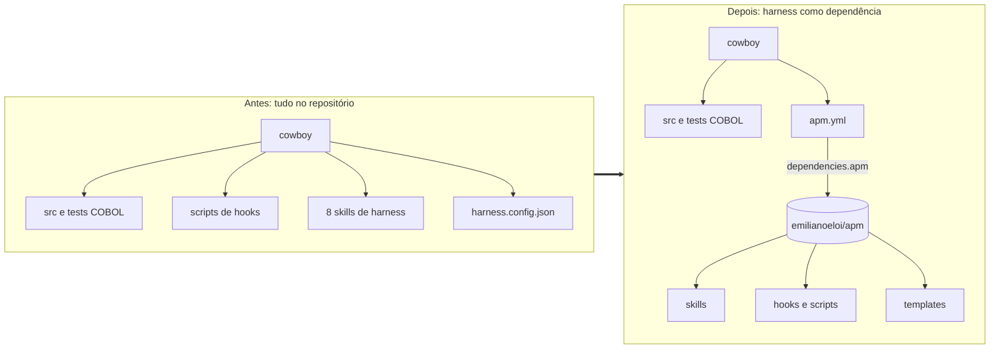
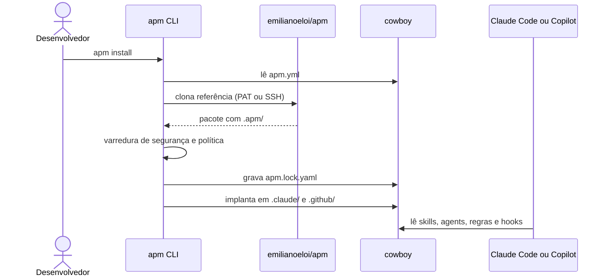
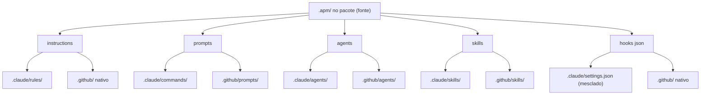
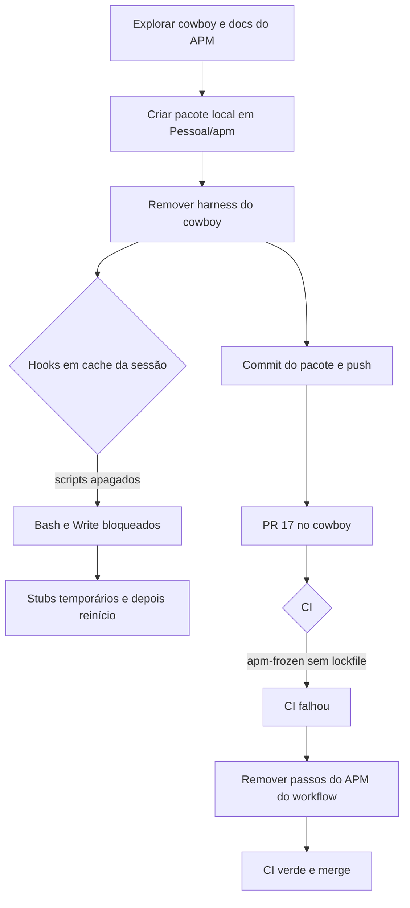
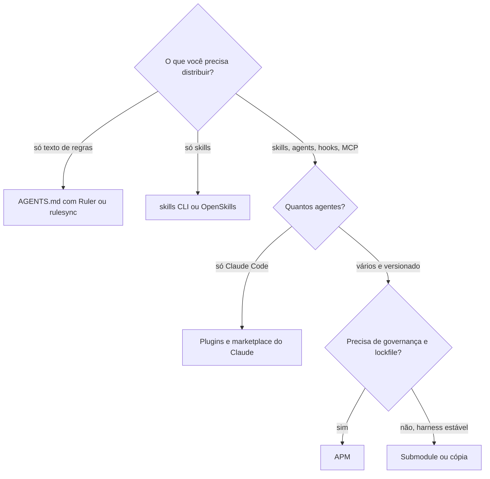
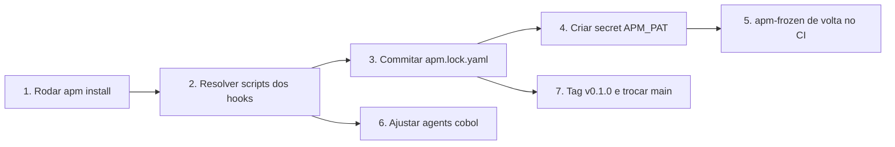

# APM no Cowboy (visão em diagramas)

Texto completo em [apm.md](apm.md); resumo em [apm.compacto.md](apm.compacto.md).

## 1. Antes e depois

## 2. Fluxo de instalação

## 3. Do pacote ao agente

## 4. Linha do tempo da migração

## 5. Escolha de ferramenta

## 6. Pendências por prioridade

